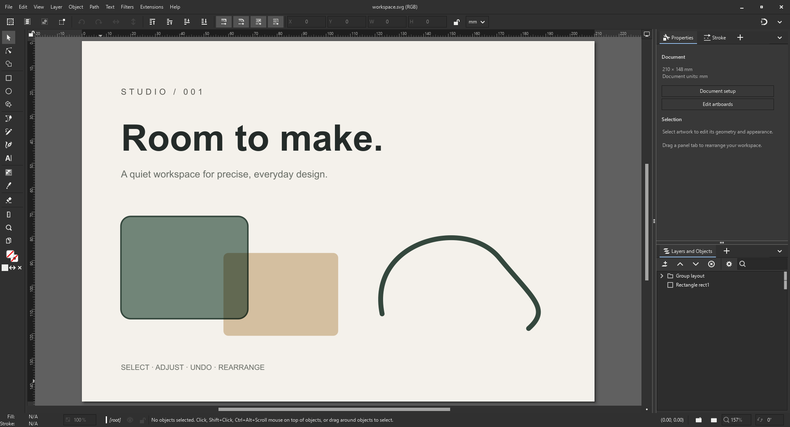

# PROOF

Vector & Print Editor with ICC Color Management and Illustrator Interchange

**We have our own Professional Industry Standard at home.**

PROOF is a heavily modified [Inkscape](https://inkscape.org/) fork focused on
professional vector, print, and production workflows. We're proud of those roots
and grateful to the Inkscape community. PROOF is developed independently, with a
cleaner workspace and a focus on precise color, practical editing, and dependable
file exchange.

## What's changed

- **A workspace focused on prepress.** Compact dark chrome, a reduced tool strip,
  contextual Properties, and dedicated Stroke and Layers panels. Panels can dock,
  float, and retain their layout; Reset Workspace gets you back to the default.
- **Document ICC color management.** RGB and CMYK working spaces, profile
  assignment, mode conversion, rendering intents, and black-point compensation
  through LittleCMS 2. Embedded profiles and process-color channels survive
  saving and reopening in PROOF SVG.
- **CMYK editing that keeps your numbers.** Fixes for picker refresh,
  profile names, and copy/paste prevent unintended channel changes during editing.
- **Spot inks and swatch libraries.** Import named inks and tints from
  PDF-compatible `.ai` and PDF artwork; load `.ase`, `.acb`, and `.ai` palettes.
  Linked spot swatches retain their ink definitions, and editing an ink updates
  its tints.
- **Illustrator interchange.** Read supported native `.ai` artwork, checked
  against its PDF pages. **Save As** writes native layers, smooth paths, inks,
  transparency and blend modes, supported linear/radial gradient fills and
  strokes, embedded pictures and local raster links; **Save a Copy** also
  offers Illustrator 7 records and PDF-based RGB interchange.
  SVG keeps features the native writer cannot write yet.
- **Editing and output fixes.** Smoother object dragging on Windows, corrected
  PDF bleed boxes, and fixes for image transforms and SVG profile imports.

## Illustrator .ai progress

**Illustrator interchange now works in both directions for a growing subset.**
PROOF reads Illustrator's own editable artwork and can write supported artwork
back as native `.ai`, with layers, named artboards and ink values. Illustrator
does not need to be installed to read or write these files.

Native output contains fresh Illustrator records and compatible PDF 1.7 pages.
It currently requires PROOF's bundled PDF backend. The optional Illustrator 7
copy format uses standalone records instead, with stricter limits: one artboard,
Windows-1252 names, opaque 8-bit embedded pictures, and no retained
document ICC profile or artboard name. Picture transparency and links remain
refused in this format.
Illustrator opening, editing and saving back into PROOF are checked with synthetic
controls, the whole Illustrator 7 subset together in one. Of the 862 of the
owner's documents PROOF reads natively, the native writer can write 646 and the
Illustrator 7 copy 99 (2026-10-21, after transparency and blend modes); spot
inks defined in Lab or RGB and live type stop most of the rest.

| Capability | Current state |
|---|---|
| Native reading | Layers, paths, clips, compound paths, gradients, patterns, supported gradient meshes, greyscale opacity masks, embedded foreign PDF vectors, process/spot colours, document ICC profiles, pictures and supported editable type |
| Safety check | Every artboard is compared with its PDF page. Unsupported or incomplete records, mismatched page counts and excessive visual differences use PDF import |
| Native writing | **Save As → Adobe Illustrator (native)** writes named artboards, layers, groups, smooth paths, compound paths and clips, with CMYK/RGB/grey paint, CMYK spot inks and tints, linear/radial gradient fills and strokes (including both on one path) with stop opacity, supported spot/ICC stops, embedded pictures and local PNG/JPEG/classic TIFF/PSD links, overprint and stroke styles, and each object's and group's transparency: opacity, the sixteen blend modes, isolated blending and knockout ([details](doc/PROOF-ai-interchange.md#transparency-and-blend-modes-in-the-modern-form-2026-10-21)) |
| Saving safely | Native records and PDF pages are written together from the current document. Unsupported features are named and the save is refused; a failed save leaves the previous file intact |
| Legacy writing | **Save a Copy → Adobe Illustrator 7** writes one artboard as editable paths, layers, CMYK inks and opaque 8-bit grayscale/RGB/CMYK pictures, without a PDF preview or the bundled PDF backend. What it keeps and refuses: [the interchange document](doc/PROOF-ai-interchange.md#the-illustrator-7-copy-what-it-keeps-and-refuses-2026-10-21) |
| Broader interchange | **Save a Copy → Illustrator interchange (PDF-based)** remains available for RGB PDF artwork. SVG keeps the working document's full PROOF features |

Recent reader work adds editable left-aligned paragraph tabs and ordinary text
on a path. Gradient meshes with bent edges now open as editable mesh cells;
the fifteen Illustrator controls and three previously refused mesh documents
pass their page comparisons. Uniform patches that become outlines are reported
as partial imports. More complex type, meshes and masks still need work.

Linked Photoshop files (`.psd` and `.psb`) and CMYK TIFFs keep their process-ink
numbers, depth and cut-out transparency in PDF output. Linked `.ai` and `.pdf`
files show their first page and print as retained PDF vectors, preserving the
placed page's fonts and inks. Changed or missing links are reported.

The reader is also checked against real documents, with artwork kept private:

| Dated reader checkpoint | Native comparison passes | PDF fallbacks |
|---|---:|---:|
| 2026-10-17 milestone: 871 copied files below 50 MB | 862 | 9 |
| 2026-10-14 separate corpus baseline: 1,395 unique files | 1,241 | 154 |

Both runs completed without errors or timeouts. These are separate corpora and
dated checkpoints; the latest milestone includes the mesh and smooth-point
reader changes. Of the 862 passes in the first row, 512 explicitly lose some
live editing semantics and 350 still need complete-editability review. Passing a visual comparison
does not mean every Illustrator control survives.

Opacity masks now support the linked, non-inverted greyscale vector subset:
Clip on or off, fills/strokes, linear/radial gradients, nested masks and
Normal/Multiply blending. Unsupported mask forms retain PDF fallback. Mask
regions are finite; geometry edits beyond the imported extent can require the
region and white backdrop to be enlarged. The PDF exporter also retains nested
mask coverage and avoids a crash on ICC-tagged gradient colours.

Embedded foreign PDFs now import as editable path/gradient groups for a bounded
vector subset, keeping page margins, clipping, CMYK values, rotation and shear.
The original embedded PDF is retained separately; SVG edits do not update it.
Unsupported PDF content retains fallback, including mesh shading and overprint.
The checks also fixed disappearing unconverted grey PDF strokes by preserving
them as black-channel CMYK.

Other remaining reader families include foreign-format
objects, advanced type, symbols and unreadable images. Brushes, blends,
compound shapes and many appearances currently keep their drawn result rather
than all of Illustrator's live controls.

For agents and contributors, start with the
[native-record reference and implementation history](doc/PROOF-ai-native-records.md)
and [native writing and interchange limits](doc/PROOF-ai-interchange.md).
The [native reader and importer](src/extension/internal/ai/) build the editable
document; [the PDF comparison and fallback](src/extension/internal/pdfinput/ai-native-open.cpp)
decide whether it is accepted. Regression fixtures are in
[the reader tests](testfiles/src/ai-native-reader-test.cpp) and
[the importer tests](testfiles/src/ai-native-import-test.cpp), with
[canvas/vector PDF mask checks](testfiles/cli_tests/ai-opacity-mask-smoke.py) and
[foreign PDF vector/CMYK checks](testfiles/cli_tests/ai-foreign-pdf-smoke.py).

Automated coverage includes reader/importer unit tests and installed-editor
checks of native saving, reopening, PDF output, masks, linked pictures and
placed pages. Writer features are also checked by opening controls in
Illustrator. See the feature documents for the evidence and its limits.

## Still in progress

**Full native `.ai` support is still in progress.** The native writer currently
refuses live type, opacity masks, patterns, spot inks defined in Lab or RGB,
transparency on layers, separate fill and stroke opacities and other
unsupported appearances. Embedded pictures and local PNG/JPEG/classic TIFF/PSD links are
written; native cached link previews, packaging and other linked formats
remain queued. Gradient writing covers non-repeating linear/radial
fills and strokes, separately or together, with stop opacity, with RGB, CMYK (in the document's
profile too) and supported spot-ink stops. Offset stroke focal points,
off-centre rotated radial strokes and reversed paint order remain refused.
Illustrator profile assignment and the spot-gradient PDF preview disagreement
remain explicit limits; see [the interchange document](doc/PROOF-ai-interchange.md).
Smooth-point flags survive, with auto/symmetric points reduced to smooth and
Illustrator choosing an open path's first-point type. The older
PDF-based RGB interchange export does not retain native layers or ink identity.
Modern `.ai` artwork without PDF-compatible content is not supported yet.
Many imported appearances and live objects retain their drawn result with
explicit import notes.

Native `.ai` writing retains supported spot names and tints; PDF spot-separation
output and the complete PDF/X workflow remain unfinished.
ICC-managed vector previews work; complete press soft proofing, overprint
simulation, and physical print matching remain unqualified. PROOF is in active
development, so check output on real jobs before relying on it for production.

## More information

- [Document color management](doc/PROOF-document-colors.md)
- [Spot inks](doc/PROOF-spot-inks.md)
- [AI interchange and its limits](doc/PROOF-ai-interchange.md)
- [Building from source](doc/building/readme.md) — inherited Inkscape build guides;
  local build scripts and dependencies may differ.
- [Inkscape](https://inkscape.org/) · [Upstream source](https://gitlab.com/inkscape/inkscape)

PROOF is free and open source. Thanks to Inkscape and the many projects behind
our tools and format research: see [Credits](CREDITS.md) and the inherited
[AUTHORS](AUTHORS) list. Licensing is documented in [COPYING](COPYING).
